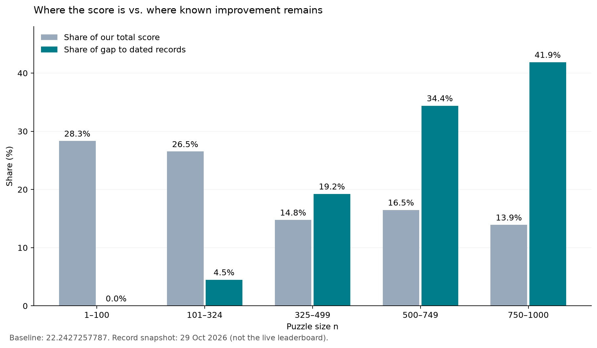

# 基线优化研究

研究日期为 2026 年 11 月 6 日。优先方向是大 n 的结构搜索：扩大 stretching 的切口与供体选择，重排斜带和直立区域，再将有效的小构型传播到多个题目。

## 已得到的结果

正式提交 Stretching v2 的 Kaggle 分数是 **22.2427257787**。更新公开布局后，Boxed In v16 的本地官方分数为 **22.238211260762**，1,000 题全部有效，改善 **0.00451452**；该文件尚未提交。[数值汇总](../../outputs/analysis/baseline/summaries/research_outcome.json)

逐题差距使用 [2026 年 10 月 29 日的纪录镜像](https://www.kaggle.com/datasets/lostdecimal27/squares-in-squares-bank)，不是实时榜。镜像只给边长，不提供领先布局坐标；差距是研究目标，不能当作预计收益。

原基线中，n≤324 占总分 54.85%，却只占已知差距 4.49%；n≥325 集中 95.51% 的差距。应按可改善空间选择题目，而不是按当前单题分数排序。

## 重点题目

令 `K=floor(sqrt(n))`，`n=K²+D`。更新至 Boxed v16 后，两组共 106 题仍有约 **0.06463** 的旧纪录差距：

| 组别 | 范围 | 题数 | 参考差距 |
| --- | --- | ---: | ---: |
| A | n=K²+K−c，K=18…31，c=7…10 | 56 | 0.036587 |
| B | n=K²+d，K=22…31，d=7…11 | 50 | 0.028043 |

先研究 **498、544、592**：它们同属 c=8，纪录的 `L−K` 均在 0.794 附近，当前约 0.824，值得寻找共享接缝模板。随后研究 **971、972、911** 的斜带重排，以及只有少量旋转方块的 **634**。[完整候选排序](../../outputs/analysis/baseline/tables/post_boxed_record_gap_candidates.csv)

## 优化顺序

1. **多切口、多供体 stretching。** 现有代码只选最大臂、中点附近第一个可用切口，并按固定 x→y 顺序伸缩。扩展臂、切口、操作顺序及带宽，保留结构不同的近优父布局。[原方案](https://www.kaggle.com/code/az05192000gmailcom/22-2427-stretching-good-packings-to-nearby-n)
2. **新构型继续松弛与压力硬化。** 对近失布局尝试 `fq` 的 `round.15c.p5`，圆角化后逐步恢复，并允许容器同步压缩。它是值得比较的搜索分支，尚未证明能改善我们的布局。
3. **改倾斜核心，再重填直立区域。** 使用 `ftmc.py`、`bandflip.py`、`fillfast.py` 改变斜带方向、交点和方块分配，避免每轮打乱整个网格。
4. **优化瓶颈矩形构件。** 用 `rectlib.py`、`mondrian.py`、`compose2.py` 裁切、压缩和组合构件，优先处理能控制多个后代布局边长的构件。非瓶颈构件的改善可能不影响最终分数。

上述实现见 [Evan Daniel 固定版本源码](https://github.com/evand/square-packing/tree/bb4cc78e5b35103c1f177db55e9cf08974e66563/search/packer)，出处见 [manifest](../../third_party/evand_manifest.json)。本地下载目录为 `third_party/evand/`，不纳入 Git。`fq` 使用角度制，Kaggle CSV 使用弧度，接入时应转换。

## 前沿研究的定位

[Ostashev 的研究](https://ostashev.ai/square-packing/)支持显式斜带、角部填充和连续松弛；其完整 GPU 生成器未公开。[Soft-to-Rigid](https://arxiv.org/html/2610.14463v1)提供替代搜索路径，但作者不认为它是更好的默认方法，实验主要针对小 n。

[Bui](https://arxiv.org/html/2508.04603v2)与 [McClenagan](https://arxiv.org/html/2602.01484v1) 的渐近构造可启发梯形端帽和渐变角度条带，不能直接保证 L≤32 的比赛收益。[全局非线性优化研究](https://arxiv.org/html/2605.04850v1)更适合尝试局部端帽或小构件。

这些算法方向尚未在项目中执行。首阶段可把 **22.23** 作为研究目标，新增收益需来自具体布局；本轮已经量化的收益来自更新公开文件。[结构化研究计划](../../outputs/analysis/baseline/summaries/research_plan.json) · [论文索引](../../data/references/literature/source_index.json)
