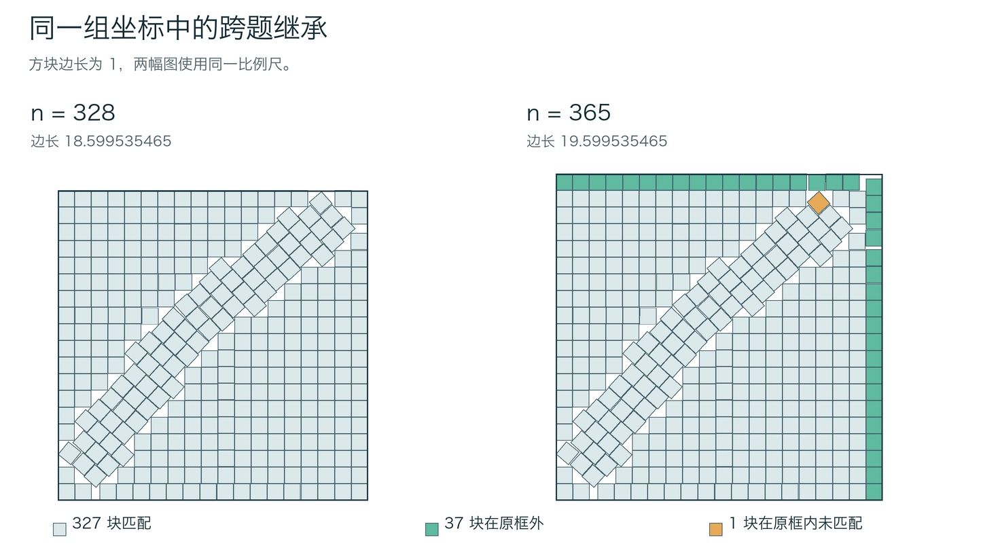

# Squares in Squares 还能从哪里降分

2026 年 11 月 19 日，北京时间。**本轮得到可用候选 22.106322870827，比上次正式提交的本地复评分降低 0.020381119559，共改善 255 个不同的题。** 对照单队榜首 22.039951081，已追回原有差距的 23.49%，还差 0.066371790。候选保存在独立目录，Kaggle 上的正式成绩仍是 22.1267039903。[候选 CSV](../outputs/research_20261119/candidate.csv) · [v20 全量评分](../outputs/research_20261119/validation/report.json) · [来源、哈希和胜题](../data/references/candidate_20261119.provenance.json) · [Kaggle 总榜](https://www.kaggle.com/competitions/squares-in-squares/leaderboard)

下一轮最值得改变的是**遗传算法的起点**。把一个题里的斜带、角部或矩形子布局移植到另一个题，先改变方块之间的接触关系，再用现有 GPU 搜索允许它们重新转动、排列。这个方向同时有本库坐标、外部独立构造和榜首选手公开经验支持。现有证据能量化一道母题成功后可带动哪些题。再降 0.01 的成功率仍需要等算力实验来测。

## 已兑现的收益

| 相同 v20 口径 | 本地总分 | 本步降分 | 实际贡献 |
|---|---:|---:|---|
| 上次正式提交对应的布局 | 22.126703990386 | — | 提交 58520513 |
| 逐题合并 11 月 19 日 prvsiyan v26 | 22.106346624692 | 0.020357365695 | 252 题 |
| 加入两批已完成的宽范围 CPU 搜索 | **22.106322870827** | **0.000023753864** | 547、644、862、915，其中 915 在上一步也改善过 |

两批 CPU 搜索的起点各不相同。它们在旧基线上分别报 21 题和 12 题获胜，对照当天公开合并结果，仅上表 4 题仍有净贡献。最大公开收益来自 328 题（总分降 0.00081904）。263 和 803 分别降约 0.00054222 和 0.00053187。最终文件含 500,500 行，文本和 float64 两条路径各验证 1,000 题。[逐题对照](../outputs/research_20261119/per_puzzle_evidence.csv) · [CPU 实验一](https://www.kaggle.com/code/ccjjllt/sis-alexkit-wide-20261118) · [CPU 实验二](https://www.kaggle.com/code/ccjjllt/sis-alexkit-wide2-20261118)

prvsiyan v26 的逐题署名显示，252 题中有 193 题取自 alexchilton 的 fault-line DP / basin hopping 输出再经抛光，48 题直接取自该输出，10 题从 11 月 18 日版本继续抛光，1 题沿用。Sergio Fernández Rubio（GeiserX）公开了总分 22.1124018632 的完整坐标及研究笔记。其逐题优于旧基线的布局，在本轮筛选精度内都被 v26 覆盖。另对照了 alexchilton v89、AHFE Feeder、Boxed In 和公开 GPU 输出。多份汇总常包含相同坐标，只按每题最终胜出的布局计算一次。v26 数据集标注 CC BY-SA 4.0，各题上游署名见原表。[v26 数据、许可及署名](https://www.kaggle.com/datasets/prvsiyan/squares-verified-best-of-1105/versions/26) · [逐题署名副本](../outputs/research_20261119/per_size_credits_1119.csv) · [GeiserX 仓库及 NOTICE](https://github.com/GeiserX/squares-in-squares)

## 剩余差距集中在哪里

11 月 19 日的逐题榜记录合计 **22.030644698252**。这相当于每道题都采用当时的最好边长，坐标未必公开。以当前候选逐题对照，净差 **0.075678172575**。下表按单题分差大于 `1e-8` 计数，分差合计保留该区间的全部题。其计算式是 `(候选边长 − 记录边长) / √n`。[逐题榜快照](../data/references/leaderboards/perpuzzle_best_20261119.csv) · [快照生成方法](../data/references/leaderboards/perpuzzle_best_20261119.provenance.json)

| 方块数 | 落后题数 | 总分差 | 占总差 |
|---|---:|---:|---:|
| 1–288 | 14 | 0.00330315 | 4.4% |
| 289–600 | 137 | 0.02404257 | 31.8% |
| 601–1000 | 223 | 0.04833245 | 63.9% |

若每题最多追平这次快照，按分差从大到小取，**再降 0.01 至少需要 12 题，再降 0.02 至少需要 32 题，追到当时单队榜首至少需要 217 题**。这些是最有利选题下的数量下限。最大单题缺口为 234（0.00119766）、491（0.00101522）、962（0.00100920）。它们适合测单题突破。原先重点运行的 24–288 区间，即使全部追平也只剩 0.00330315。GPU 搜索在小题上更便宜，仍适合检验方法。[完整逐题差值](../outputs/research_20261119/per_puzzle_evidence.csv)

## 从已有坐标检验跨题复用

对方块四个顶点的外包框做贴角对齐，考虑正方形的 8 种旋转或镜像。中心距小于 0.05 个单位、角度差按 90° 取模后小于 0.5° 算匹配。这两组布局中，通过该容差的匹配均为一对一。

- **328 → 365**。同向贴左下角，328 块中有 327 块匹配。365 题中另外 37 块的中心在原框外，均近乎轴向，另有 1 块在原框内。把容差收紧到 0.01 和 0.1°，仍有 323 块匹配。旧正式提交中同样两题的 66 块明显倾斜方块，在贴角对齐后没有一块匹配。新坐标显示，一项斜带构造能跨题保留。
- **747 → 803**。两题边长的小数部分均约为 0.796130876，贴角后匹配 641/747 块。旧框内仍有 107 块不匹配。这里可以复用的是布局的一部分，需要重做内部或端部。仅看相同的小数部分，会高估完整几何结构的相似性。

两项比较使用候选 CSV 中的实际坐标，只说明几何相似性。生成方法的作者归属以数据集的逐题记录为准。[坐标](../outputs/research_20261119/candidate.csv) · [prvsiyan v26](https://www.kaggle.com/datasets/prvsiyan/squares-verified-best-of-1105/versions/26)

**单纯删块和加圈已经接近这套坐标的极限。** 对最终候选的 999 对 `n+1 → n`，逐一算出删除任一块后能达到的最小边长，没有超过 `1e-8` 的边长改善。进一步检查 42,132 对较大供体与较小非完全平方目标题，差块数最多约一圈。固定方块的相对姿态，允许任意删块和平移裁剪框，仍为零胜。检验方法是把每个待保留方块变成裁剪框左下角的可行矩形，在目标边长下求这些矩形的最大重叠数。这个结果指向切开后改变接缝、方向或排列的操作。[本地坐标](../outputs/research_20261119/candidate.csv) · [以往插入、删块及刚性构造实验](../data/references/cleanup_history.json)

## 推荐框架与外部证据

**1. 主攻跨题斜带拼接，复用现有 GPU 岛式遗传算法。** 从已验证布局提取沿面相接的倾斜方块链，把周期和两端阶梯形状一起保留。候选起点可由删去一个周期、复制有重叠的周期，或对接两个不同题的带端生成。对轴向块做计数和填补，释放接缝两侧块的位置和角度，必要时连同同排远端方块移动。随后用项目已有的 GA 和 v20 认证收尾。保留不同接触关系的起点，即使它暂时比当前最优宽一些。历史上该 GA 已在本项目产生约 0.0012 的一轮收益。直接抛光当前布局的实验则在 396 题上零胜。[本项目历史](research.md) · [Jeroen Cottaar 的冠军 GA 与 GPU 松弛实现](https://github.com/jcottaar/packing)

- **同题的公开构造**。Ono 从 229 题布局切去一个斜带周期、平移两侧并修缝，在 147 题比当时登记边长缩短约 0.00581。de Winter 从 146 题提取 37 块斜带，错位复制并共享 15 块，得到 59 块连续斜带，再填 233 个轴向块并自由优化完整的 292 块。两例都说明可以更换接触关系再做连续优化。Ono 对约 7,800 份公开布局的大范围扫描只在 147 和 228 题优于当时登记册，支持按周期筛选供体。本库 147 已有同等或更好的布局，可作恢复实验的对照。[Ono 的实验及负结果](https://github.com/RobertoOno/squares-in-square/blob/fce076f2bf459a25be3645d899e8950b93ed977c/runs/2026-11-11_fable-5.2/REPORT.md) · [de Winter 构造及坐标证书](https://github.com/jlevy/squares/issues/1006)
- **有同场比赛规模的开源实现**。GeiserX 的 `k123` 记录了一次从 229 的四块宽链带出发、跨规模拼接，在作者当时的基线上 15 题合计降低 0.005015。其 `family_step` 会识别两臂的堆叠、抽换一排并释放接缝，其 `modules` 支持替换角部与远端区。本库早先对 1,166 份供体和约 14,800 个构件的 fault-line DP 扫描没有认证赢家。值得复用的是带端配准、共享方块和带角度自由度的修复，并用今天的基线重测增量。[GeiserX 的带拼接实测](https://github.com/GeiserX/squares-in-squares/blob/main/avenues/k123.md) · [跨规模生成器](https://github.com/GeiserX/squares-in-squares/blob/main/avenues/family.md) · [本库历史](../data/references/cleanup_history.json)
- **倾斜带的取值需要搜索**。榜首选手 pjmathematician 公开建议在大题上分别改变对角带的宽度和偏移，从多个刚性起点松弛，让不同角度自然形成。同帖另一位选手报告，直带加固定填充在 498 题仍会回到旧布局。两者给出了值得变化的参数，也给出了直接照搬时的失败样例。Gensane 与 Ryckelynck 的论文在 11、29、37 块的同形问题上改进过当时的记录，支持扰动与压缩的机制。千块规模的选择依据来自比赛实测。[榜首选手回复与复现实验](https://www.kaggle.com/competitions/squares-in-squares/discussion/755628) · [原论文](https://doi.org/10.1007/s00454-004-1129-z)

**2. 备选矩形子布局，让两块先分别适配。** 从两个供体裁出矩形，各自在不同长宽比下优化，允许一块裁去角部供另一块嵌入，再放入目标容器、填剩余空间并解除接缝约束。SQUISH 公开的 9 个历史案例以此取得了约 0.00087–0.010 的单题边长改进。早先本库测试的固定矩形分割和刚性块移动均收益低。该变体值得验证的增量，具体落在独立改变子块长宽比、重做端部接触，以及保留多种可行接口上。[SQUISH 构造与核验](https://github.com/jlevy/squares/issues/500) · [GeiserX 的端部模块及局限](https://github.com/GeiserX/squares-in-squares/blob/main/avenues/modules.md)

**3. 扩散模型暂列备选，先保留其几何对照。** 11 月 19 日，LazyCharles07 报告从 848 裁出两个模块，组合成 969 题并将边长压至 31.607581650。相对本轮候选的 31.618993679，这一个例子若能复现可再降约 **0.00036661**。公开帖给出了边长，未找到可独立评分的坐标。作者在 46 次留出模块试验中，扩散生成与直接几何修复均取得 12 次认证改善。现阶段支持投入的是几何重组。训练模型需要先在同样起点和预算下超过直接修复。另一组选手在 651 题用已知更优供体做回放，6 块协同改变可恢复 40% 收益，包含对侧墙块，提示修复区域有时应沿接触链延伸。[模块、扩散模型和留出结果](https://www.kaggle.com/competitions/squares-in-squares/discussion/760352) · [651 题的供体回放](https://www.kaggle.com/competitions/squares-in-squares/discussion/760106)

**前沿通用求解器可以替换修缝步骤。** Gardeyn 等人的开源 Sparrow 把不规则条带装填拆成一系列固定尺寸下的可行性问题，持续发生碰撞的方块对得到更高权重。若拼接后反复卡在同几对碰撞上，可以与现有修复器做一次同起点对照，最终贴边布局仍交给本项目 v20 验证。Berthold 等人的 2026 年预印本用 Farkas 引理表示自由旋转多边形的分离条件，可用于让一个小接缝里的方块换位。论文的多边形改进实例规模与数百块的整题相距很远。两者在本项目上的新增分数均待实测。[Sparrow 论文](https://arxiv.org/abs/2509.13329) · [Rust 实现](https://github.com/JeroenGar/sparrow) · [自由旋转的全局优化模型](https://arxiv.org/abs/2605.04850)

## 哪些题值得分配算力

若独立找到 `m` 块、边长 `L` 的合法布局，外接一条单位宽的 L 形边，可以增加 `2⌊L⌋+1` 块。增加 `j` 层后，边长至多为 `L+j`，块数为 `m+2j⌊L⌋+j²`。多余的块可以删除。对当前 1,000 个已知布局做这一闭包检查，在边长改善 `1e-8` 的门槛下零胜。新母题一旦取得进展，就可直接用该式核算后代价值。加入外圈后仍应对实际写出的坐标做双路径检查。[Friedman 的构造](https://erich-friedman.github.io/papers/squares/squares.html) · [本轮逐题对照](../outputs/research_20261119/per_puzzle_evidence.csv)

| 母题 | 当前边长 → 已见纪录边长 | 重现纪录后可改善的题 | 去重条件收益 |
|---|---|---|---:|
| **730** | 27.520815280 → 27.498475950 | 730、785、842、901、962 | **0.00385849** |
| **678** | 26.535533906 → 26.523859951 | 678、731、786、843、902、963 | **0.00246347** |
| **两题合计** | 两个不同构造分别成功 | 11 个不同目标 | **0.00632195** |

还有较低的可证伪门槛。730 若只缩边 0.001，五题也可合计降约 **0.00017272**。固定原坐标轴朝向，即使允许容器平移，为达到这个尺寸也至少要改变当前 730 题中 50 块的位置或姿态。这些块可以成组移动。刚性核直接压缩过去已失败，应将计算花在新的带端或边界排列上。要再降 0.01，仅解决这两道母题到表中纪录仍差约 0.00368，需同时覆盖其他构造族。[当前坐标与逐题纪录](../outputs/research_20261119/per_puzzle_evidence.csv)

## 第一轮对照实验

以下是建议的远端试验预算和判据。几何候选的搜寻尚未在这组新起点上运行。

1. **先复现操作。** 用公开的 229 → 147 斜切案例检验删带、平移、自由角修缝和精度处理，产出同规模、合法且接近公开边长的布局。另用上图 328 → 365 检验构件对齐和外圈操作。复现的已知题不计入新收益。
2. **选六题，固定对照。** 730、678 检验家族传播，234、491 检验大单题缺口，803 检验部分斜带继承，969 检验矩形拼接。A 组用当前候选作为岛式 GA 起点，B 组用跨题斜带或矩形重组作为起点。共享同一个松弛器、搜索参数和随机种子，每题每组 3 个种子，每次 10 分钟，总预算 6 GPU 小时。母题允许使用其他题的已知供体，禁止直接读入目标题的更优答案作为试验起点，逐一保存供体和操作。
3. **按每 GPU 小时的认证降分决策。** 单独列出直接搜索与外圈传播的题数，逐题择优后再汇总。若 B 组在至少两个独立母题上超过 A、合并总收益也超过 A，再扩大同族目标。若控制题可复现而新母题零胜，先更换供体类型或接缝机制。得分相同但拓扑不同的结果可保存为后续起点，暂记零收益。

用于复算的基线、候选、逐题榜和取数阈值均保留在仓库。高精度边长只用于核对公开纪录，正式分数以实际 CSV 的两种解析结果为准。[候选与数据来源](../data/references/candidate_20261119.provenance.json) · [官方指标及使用方式](guide.md)
